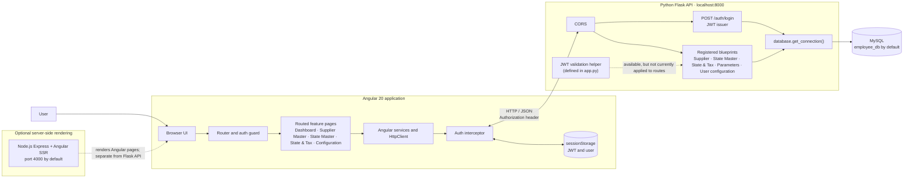

# Application architecture

## Request and authentication flow

1. The Angular router loads the login page or guards the application layout.
2. `AuthService` sends login credentials to `POST /auth/login`. On success, it stores the returned JWT and user in browser `sessionStorage`.
3. Angular services make API requests through `HttpClient`; the auth interceptor adds the stored JWT as a bearer token.
4. Flask handles authentication and the registered feature blueprints, which access MySQL through `database.get_connection()`.
5. The optional Express SSR server renders Angular pages. It is not the API server.

The backend defines a JWT validation helper, but the registered route handlers do not currently use it as a decorator. The diagram therefore does not imply that API routes enforce the bearer token.

Employee feature code is present in the repository, but it is not currently registered in the root application routes.

`/master/statemaster` loads the State Master CRUD page (state code, state name, country, capital, and status). Its country options come from Parameter country data. State names in the first table column open records for editing; the last column contains delete actions. `/master/state-tax` loads the separate State & Tax CRUD page.

## Runtime endpoints

- Local Angular development server: `http://localhost:4200`
- Local Flask API: `http://127.0.0.1:8000`
- Optional Angular SSR server: `http://localhost:4000`
- Production Angular API base URL: configured in `src/app/Environment/environment.prod.ts`
